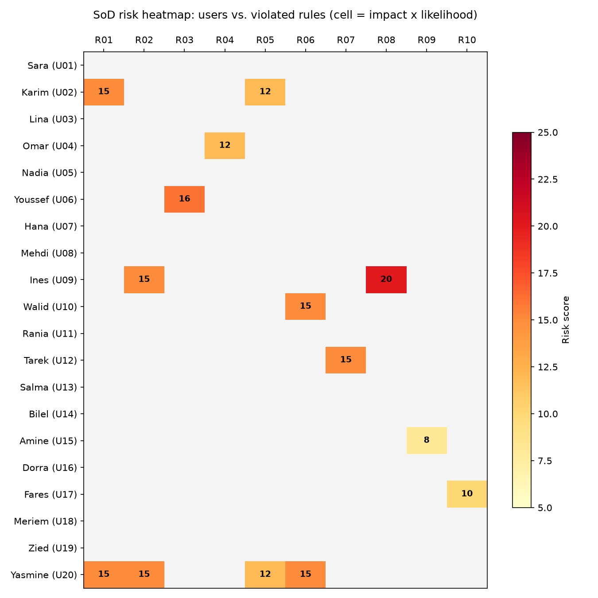

# ERP Separation of Duties (SoD) Audit

A Python/pandas project that audits access rights in an ERP for **Separation of Duties** conflicts, scores each finding by risk, proposes remediation, and verifies the fix by re-running the audit.

It is a hands-on version of an IAM governance topic: assess access, build a role model, detect SoD conflicts, remediate, and report against ISO 27001 and NIST.

## What it does

1. Loads users, roles and permissions, plus a matrix of forbidden permission pairs (the SoD rules).
2. Expands each user's roles into permissions and checks every rule.
3. Scores each conflict as impact x likelihood and classifies it (LOW to CRITICAL).
4. Proposes the smallest role change that clears each user's conflicts.
5. Re-runs the audit on the corrected data to prove the fix.

## Results on the simulated dataset

| Metric                              | Value             |
| ----------------------------------- | ----------------- |
| Users / roles / permissions / rules | 20 / 11 / 11 / 10 |
| Users with conflicts                | 9 of 20           |
| Conflicts found                     | 14                |
| Conflicts after remediation         | 0                 |

The worst finding is a user who can both change vendor bank details and execute payments (risk score 20). Two conflicts come from a badly designed role (`SUPER_FINANCE`), so fixing the role matters more than fixing individual users.



## Run it

```
pip install pandas matplotlib
python src/sod_check.py
python src/remediation.py
```

## Project layout

```
data/     sod_rules.csv, roles.csv, users.csv   (simulated ERP export)
src/      sod_check.py, remediation.py, step2..step6 (learning scripts)
reports/  findings, heatmap, remediation plan, controls, report.md
```

## Standards mapping

ISO 27001:2022 A.5.3, A.5.15, A.5.18, A.8.2 and NIST SP 800-53 AC-2, AC-5, AC-6. Details are in `reports/report.md`.

## Limits

The data is simulated and the rule set is small (10 rules). Real ERP audits use hundreds of rules at transaction level and depend on organizational scope. The method transfers; the results do not.

## Next

Run the same pipeline on a real Odoo export, with rules written for Odoo's actual security groups.
